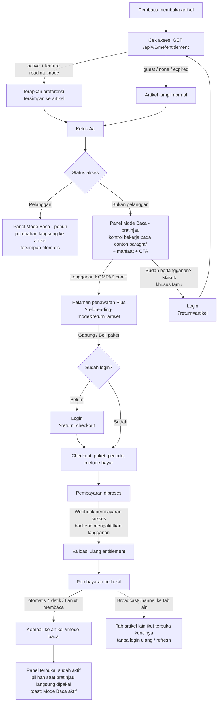

# Reading Mode — KOMPAS.com+ premium access control

Fitur untuk pelanggan KOMPAS.com+ di halaman artikel: ubah **ukuran teks**, **jenis huruf**, **jarak baris**, **teks tebal**, **rata kanan-kiri**, dan **6 tema baca** (Asli, Tenang, Kertas, Tegas, Hangat, Fokus) — terinspirasi panel *Themes & Settings* Apple Books.

## Titik masuk

| Tempat | Bentuk | Catatan |
|---|---|---|
| Baris breadcrumb artikel | Ikon **Aa** (Icon Button, outline) | Selalu terlihat di awal artikel |
| Saat membaca isi artikel | Tombol **Aa** melayang kanan bawah | Muncul hanya selama isi artikel di layar |

Penanda di pojok ikon: **gembok oranye** = terkunci (bukan pelanggan), **mahkota biru** = aktif (pelanggan Plus). Ikon *Aa* dipilih karena sudah dikenal sebagai pengaturan teks (Apple Books, Kindle, Medium).

## Flow



## Status akses

| Status dari backend | Artikel | Panel | CTA |
|---|---|---|---|
| `guest` (belum login) | Normal | Pratinjau | **Langganan KOMPAS.com+** + *Sudah berlangganan? Masuk* |
| `none` (login, belum langganan) | Normal | Pratinjau | **Langganan KOMPAS.com+** |
| `active` + `reading_mode` | Gaya Mode Baca diterapkan | Penuh | — |
| `expired` | Kembali normal (preferensi tetap tersimpan) | Pratinjau | **Perpanjang langganan** |
| sedang dicek | Normal | Kontrol redup sementara | — |

## Aturan akses

1. **Backend adalah satu-satunya sumber kebenaran.** UI hanya merender hasil `GET /api/v1/me/entitlement`; tidak ada flag lokal yang bisa membuka fitur.
2. **Dicek ulang** saat halaman dibuka, saat tab kembali aktif (`visibilitychange`), saat sesi berubah, dan saat ada sinyal `entitlement-changed` dari tab lain.
3. **Setelah bayar tanpa sesi baru**: webhook pembayaran mengaktifkan langganan di server → checkout memvalidasi ulang → semua tab diberi sinyal → artikel langsung terbuka kuncinya.
4. **Preferensi** disimpan per perangkat (`localStorage`), tapi hanya **diterapkan** kalau entitlement aktif. Pilihan saat pratinjau dibawa ke sesi setelah pembelian.

## Kontrak API (untuk tim backend)

```http
GET /api/v1/me/entitlement
Cookie: session=…

200 OK
{
  "status": "active" | "none" | "expired",
  "plan": "lite" | "max" | "one" | null,
  "period": "monthly" | "yearly" | null,
  "expiresAt": "2026-11-28T05:45:00Z" | null,
  "features": ["reading_mode", "ad_free", ...]
}

401 Unauthorized → dianggap "guest"
```

Disarankan: respons `Cache-Control: no-store`, dan setelah webhook pembayaran sukses server mengirim event (mis. SSE/WebSocket) supaya aplikasi tidak perlu polling.

## Di prototipe ini

| Bagian | File |
|---|---|
| Panel + gate + penerapan gaya | `src/js/reading-mode.js`, `src/styles/components/reading-mode.css` |
| Entitlement (mock backend, watcher, broadcast) | `src/js/utils/entitlement.js` |
| Checkout (mock pembayaran) | `checkout.html`, `src/js/checkout.js`, `src/styles/pages/checkout.css` |
| Token Design System 3.0 | `src/styles/tokens/kds-tokens.css` |

Bantuan demo:
- `account.html?state=guest` — keluar (kembali jadi tamu)
- `checkout.html?reset=1` — hapus langganan akun yang sedang login
- Harga di checkout adalah contoh, bukan harga resmi.

## Catatan design system

- Semua warna, radius, spacing, dan bayangan memakai token `--kds-*`; panel otomatis ikut **dark** saat tema baca gelap (Tenang) dipilih.
- Komponen resmi yang dipakai: Bottom sheet (*Floating*), Icon Button, Button (*XLarge Primary Solid*, *Large Secondary Ghost*), Badge, In-Body Alert (toast sukses).
- **Pola baru di luar system**: kontrol tersegmentasi (A/A, rata/tebal), kartu tema, dan radio card checkout — disusun dari token dasar.
- **Penyimpangan yang disengaja**: design system hanya memakai **Inter**, tetapi fitur ini meminta ganti font. Pilihan **Serif** (font sistem) dan **Hyperlegible** (Atkinson Hyperlegible, dimuat hanya saat dipilih) hanya berlaku untuk **isi artikel** sebagai preferensi pembaca; seluruh UI tetap Inter. Warna latar tema baca (Hangat, Fokus) juga belum ada di token — perlu diputuskan tim desain.
