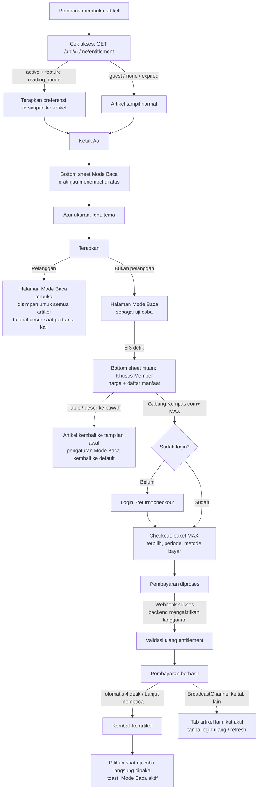

# Reading Mode — KOMPAS.com+ premium access control

Fitur untuk pelanggan KOMPAS.com+ di halaman artikel: ubah **ukuran teks** (6 tingkat), **teks tebal**, **rata kanan-kiri**, **jenis huruf** (6 font), dan **6 tema baca** (Asli, Tenang, Kertas, Tegas, Hangat, Fokus) — terinspirasi panel *Themes & Settings* Apple Books.

## Titik masuk

| Tempat | Bentuk | Catatan |
|---|---|---|
| Baris reaksi atas artikel | Tombol **Aa** pertama, di sebelah *Add on Google* (Figma 11781:34669) | Baris bisa digeser ke samping |
| Baris reaksi di akhir artikel | Sama persis dengan baris atas | Di atas teaser komentar |
| Saat membaca isi artikel | Tombol **Aa** melayang kanan bawah | Khusus pelanggan; muncul hanya selama isi artikel di layar |

## Bottom sheet (Figma 11763:34346)

- **Atas, menempel:** grabber, judul *Mode Baca* + tutup, dan kartu **Pratinjau** yang langsung menampilkan pilihan (tema, font, ukuran, tebal, rata).
- **Tengah, bisa di-scroll:** *Ukuran font* (slider A–A + tombol rata/tebal), *Font yang digunakan*, *Tema*, *Pengaturan awal*.
- **Bawah, menempel:** tombol **Terapkan**.

Artikel tidak berubah sebelum *Terapkan* ditekan.

## Halaman Mode Baca (Figma 11754:28318)

*Terapkan* membuka halaman baca imersif di atas artikel (`src/js/reader.js`):

- Foto penuh di atas, judul + penulis di atas latar hitam, lalu hanya isi artikel (tanpa iklan dan feed) dengan gaya pilihan pembaca.
- **Header dan bar bawah** tersembunyi saat scroll ke bawah; **ketuk di mana saja** untuk memunculkannya lagi.
- **Bar bawah:** *Artikel lainnya* (bottom sheet 20 artikel terkait: kanal yang sama dulu, lalu terbaru), **‹ ›** pindah artikel (juga **geser kiri/kanan** atau tombol panah keyboard), **Aa** pengaturan, **X** keluar.
- Pindah artikel memakai **lipatan kertas (page curl)**: saat swipe, tepi halaman mengikuti jari, terlipat dengan sisi belakang kertas dan bayangan, halaman berikutnya terlihat di bawahnya. Dilepas sebelum ±30% (dan tanpa sentakan cepat) → batal, halaman menutup kembali. Tombol ‹ › membalik dari sudut kanan bawah. URL ikut berganti (`?id=`); artikel tetangga dimuat lebih dulu.
- **X** meminta konfirmasi *Tutup Mode Baca?* Setelah keluar, artikel tampil biasa; pengaturan tetap tersimpan.
- Untuk pelanggan, halaman baca tetap terbuka di setiap artikel sampai ditutup lewat X.
- **Tutorial geser** muncul sekali, saat member pertama kali masuk halaman baca.

## Flow



## Status akses

| Status dari backend | Artikel | Setelah *Terapkan* | CTA sheet hitam |
|---|---|---|---|
| `guest` (belum login) | Normal | Uji coba di artikel ini → sheet hitam | **Gabung Kompas.com+ MAX** (checkout meminta login) |
| `none` (login, belum langganan) | Normal | Uji coba di artikel ini → sheet hitam | **Gabung Kompas.com+ MAX** |
| `active` + `reading_mode` | Gaya Mode Baca diterapkan | Disimpan untuk semua artikel | — |
| `expired` | Kembali normal (preferensi tetap tersimpan) | Uji coba di artikel ini → sheet hitam | **Perpanjang Kompas.com+ MAX** |
| sedang dicek | Normal | — | — |

## Tampilan untuk member (Figma 11781:34935)

Saat entitlement `active`, di **semua halaman** (home, artikel, MyValue, Karin):

- Logo header menjadi **KOMPAS.com+**.
- **Tanpa iklan** (semua elemen `aria-label="Iklan"`, plus iklan di jawaban Karin).

Khusus halaman artikel:

- Ikon K+ di header disembunyikan.
- **Artikel utuh dalam 1 halaman**: paginasi Halaman 1–3 disembunyikan, semua paragraf tampil.
- Polling di dalam artikel disembunyikan (mengikuti desain).
- Tombol **Aa** melayang tersedia.

## Aturan akses

1. **Backend adalah satu-satunya sumber kebenaran.** UI hanya merender hasil `GET /api/v1/me/entitlement`; tidak ada flag lokal yang bisa membuka fitur secara permanen.
2. **Uji coba bukan akses.** Untuk non-pelanggan, gaya hanya dipasang di halaman yang sedang dibuka dan hilang saat sheet hitam ditutup atau halaman dimuat ulang.
3. **Dicek ulang** saat halaman dibuka, saat tab kembali aktif (`visibilitychange`), saat sesi berubah, dan saat ada sinyal `entitlement-changed` dari tab lain.
4. **Setelah bayar tanpa sesi baru**: webhook pembayaran mengaktifkan langganan di server → checkout memvalidasi ulang → semua tab diberi sinyal → artikel langsung memakai Mode Baca.
5. **Preferensi** disimpan per perangkat (`localStorage`), tapi hanya **diterapkan permanen** kalau entitlement aktif. Pilihan saat uji coba (`sessionStorage`) dibawa ke sesi setelah pembelian.

## Kontrak API (untuk tim backend)

```http
GET /api/v1/me/entitlement
Cookie: session=…

200 OK
{
  "status": "active" | "none" | "expired",
  "plan": "lite" | "max" | "one" | null,
  "period": "monthly" | "yearly" | null,
  "expiresAt": "2026-11-28T05:45:00Z" | null,
  "features": ["reading_mode", "ad_free", ...]
}

401 Unauthorized → dianggap "guest"
```

Disarankan: respons `Cache-Control: no-store`, dan setelah webhook pembayaran sukses server mengirim event (mis. SSE/WebSocket) supaya aplikasi tidak perlu polling.

## Font (semua lisensi SIL Open Font License, kecuali Inter yang juga OFL)

| Font | Jenis | Catatan |
|---|---|---|
| Inter | Sans-serif | Font UI KOMPAS.com, bawaan |
| Lora | Serif | Font bawaan tema Tenang, Kertas, Hangat |
| Merriweather | Serif | Dirancang untuk layar |
| Playfair Display | Serif | Kontras tinggi, cocok untuk ukuran besar |
| Lato | Sans-serif | Hangat dan stabil untuk teks panjang |
| Work Sans | Sans-serif | Bersih, nyaman di ukuran teks badan |

Font tambahan dimuat dari Google Fonts hanya saat bottom sheet dibuka atau preferensi memakainya.

## Di prototipe ini

| Bagian | File |
|---|---|
| Bottom sheet, uji coba, sheet hitam, penerapan gaya | `src/js/reading-mode.js`, `src/styles/components/reading-mode.css` |
| Halaman Mode Baca, artikel lainnya, balik halaman, tutorial | `src/js/reader.js`, `src/styles/components/reader.css` |
| Baris reaksi atas | `article-detail.html`, `src/styles/pages/article.css` (`.art-react`) |
| Entitlement (mock backend, watcher, broadcast) | `src/js/utils/entitlement.js` |
| Checkout (mock pembayaran) | `checkout.html`, `src/js/checkout.js`, `src/styles/pages/checkout.css` |
| Token Design System 3.0 | `src/styles/tokens/kds-tokens.css` |

Bantuan demo:
- `index.html?member=1` — home sebagai pelanggan KOMPAS.com+ MAX (login akun demo *Pembaca Plus* bila belum login, lalu aktifkan langganan)
- `index.html?member=0` — home sebagai non-pelanggan (langganan dihapus, tetap login)
- `account.html?state=guest` — keluar (kembali jadi tamu)
- Akun → **Profil** → menu ⋮ → **Logout** — keluar; kalau member, langganan demo ikut dihapus sehingga situs kembali ke tampilan non-member
- `checkout.html?reset=1` — hapus langganan akun yang sedang login
- Harga di checkout adalah contoh, bukan harga resmi.

## Catatan design system

- Semua warna, radius, spacing, dan bayangan memakai token `--kds-*`. Sheet hitam (Figma 11781:34846) memakai latar `--kds-base-black` dengan neutral mode terang (`data-theme="light"`) untuk tag, tombol tutup, dan garis pemisah.
- Komponen resmi yang dipakai: Bottom sheet (*Sticky* — menempel di bawah layar, bisa digeser ke bawah untuk menutup), Icon Button, Button (*XLarge Primary Solid*), In-Body Alert (toast sukses).
- **Pola baru di luar system**: kontrol tersegmentasi (rata/tebal), slider ukuran 6 titik, daftar font, dan kartu tema — disusun dari token dasar. Tag *Pratinjau* memakai Blue 10 (`#E1F0FF`) yang belum ada sebagai token semantik.
- **Penyimpangan yang disengaja**: design system hanya memakai **Inter**, tetapi fitur ini meminta ganti font. Font tambahan hanya berlaku untuk **isi artikel** sebagai preferensi pembaca; seluruh UI tetap Inter. Warna latar tema baca (Hangat, Fokus) juga belum ada di token — perlu diputuskan tim desain.
